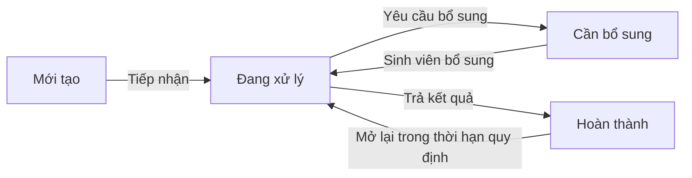

# UniSupport — Student Support Management System

> **Dự án mô phỏng cho môn Software Project Management.** Repository này dùng để lập kế hoạch, đặc tả yêu cầu và theo dõi việc thực hiện một dự án phần mềm giả định cho Aurora University. Các chức năng, mốc phát hành và hoạt động bàn giao bên dưới là **phạm vi/kế hoạch của tình huống học tập**, không phải tuyên bố rằng một hệ thống Production đã được xây dựng hoặc vận hành. Dự án không yêu cầu có đầy đủ mã nguồn.

## Mục lục

- [1. Tổng quan](#1-tổng-quan)
- [2. Nguồn chuẩn và cách đọc repository](#2-nguồn-chuẩn-và-cách-đọc-repository)
- [3. Phạm vi sản phẩm giả định](#3-phạm-vi-sản-phẩm-giả-định)
- [4. Quy trình xử lý Ticket](#4-quy-trình-xử-lý-ticket)
- [5. Kế hoạch 23 tuần](#5-kế-hoạch-23-tuần)
- [6. GitHub Milestones và Master Schedule](#6-github-milestones-và-master-schedule)
- [7. Quy trình quản lý công việc](#7-quy-trình-quản-lý-công-việc)
- [8. Tiêu chí đánh giá và các điểm cần xác nhận](#8-tiêu-chí-đánh-giá-và-các-điểm-cần-xác-nhận)

## 1. Tổng quan

Trong tình huống giả định, Aurora University cần một cổng Web tập trung để sinh viên gửi yêu cầu hỗ trợ, theo dõi tiến độ và nhận kết quả. Các phòng ban tiếp nhận, phân luồng, xử lý Ticket; quản lý theo dõi thời hạn, khối lượng công việc và báo cáo. Quy mô đặt ra trong Proposal là khoảng **3.000 sinh viên**.

Mục tiêu của bài làm là thể hiện cách quản lý một dự án phần mềm từ xác định yêu cầu đến bàn giao: xác lập phạm vi, chia công việc, ước lượng lịch 23 tuần, quản lý phụ thuộc, theo dõi tiến độ, kiểm soát thay đổi và mô tả tiêu chí nghiệm thu. **Issue hoặc milestone được lập không có nghĩa là chức năng đã được lập trình xong.** Một issue chỉ được đánh dấu Done/Close khi có bằng chứng cho đầu ra đã định nghĩa trong issue đó, chẳng hạn tài liệu đã được review, prototype đã được duyệt hoặc phần việc mô phỏng đã hoàn tất.

### Các bên liên quan và vai trò trong hệ thống giả định

| Vai trò | Nhu cầu và trách nhiệm dự kiến |
| --- | --- |
| **Student — Sinh viên** | Tạo, theo dõi và bổ sung Ticket; nhận phản hồi, tra cứu FAQ, đánh giá kết quả. |
| **Staff — Cán bộ xử lý** | Tiếp nhận Ticket trong phạm vi được giao, yêu cầu bổ sung, xử lý, ghi chú nội bộ và trả kết quả. |
| **Manager — Quản lý** | Theo dõi tiến độ, Ticket tồn đọng, thời hạn và khối lượng công việc; phân công lại khi cần. |
| **Administrator — Quản trị viên** | Quản lý tài khoản, vai trò, danh mục, phòng ban, quy tắc phân luồng, FAQ và mẫu phản hồi. |

Theo quyết định nghiệp vụ của bài làm, **trường cấp tài khoản cho sinh viên và cán bộ**. Người dùng không tự đăng ký công khai. Sản phẩm giả định có bốn vai trò và phải kiểm tra quyền theo cả chức năng lẫn phạm vi dữ liệu.

## 2. Nguồn chuẩn và cách đọc repository

**`Software Project Management.md` (Proposal) là nguồn chuẩn cao nhất** cho phạm vi, lịch 23 tuần và các mốc M1–M4. Hai tài liệu `Software Project Management (1).md` (PRD) và `Software Project Management (2).md` (Team Charter) làm rõ yêu cầu và cách phối hợp. Khi có nội dung mâu thuẫn, ưu tiên Proposal; các quyết định cụ thể phát sinh sau đó được ghi trong issue và milestone của repository này.

| Nơi theo dõi | Nội dung | Cách sử dụng |
| --- | --- | --- |
| **README này** | Bối cảnh, phạm vi, lịch và quy ước chung. | Bắt đầu đọc tại đây. |
| [GitHub Issues](https://github.com/vinhdai123/UniSupport_Project/issues) | Feature, task, sub-issue, tiêu chí hoàn thành và bằng chứng. | Xem đầu ra cần làm và trạng thái từng việc. |
| [GitHub Milestones](https://github.com/vinhdai123/UniSupport_Project/milestones) | Các nhóm kết quả cần đạt theo hạn. | Xem phạm vi và tiến độ của từng mốc. |
| **Master Schedule** trong [tab Projects của repository](https://github.com/vinhdai123/UniSupport_Project/projects) | Lịch, trạng thái và phụ thuộc công việc. | Theo dõi tiến độ tổng hợp của **UniSupport_Project**. |
| `docs/` trong lịch sử repository | Tài liệu sản phẩm, quy tắc nghiệp vụ và PRD theo module. | Đọc khi cần chi tiết; đối chiếu với Proposal nếu có khác biệt. |

Các tệp Proposal/PRD/Team Charter là tài liệu đầu vào của bài làm; không cần mã nguồn đầy đủ để đọc kế hoạch. Mã giao diện hoặc dữ liệu giả lập, nếu có trong một bản làm việc, chỉ dùng để minh họa ý tưởng và **không tự chứng minh các chức năng trong phạm vi đã hoàn thành**.

## 3. Phạm vi sản phẩm giả định

### Trong phạm vi

| Nhóm | Yêu cầu dự kiến |
| --- | --- |
| **Tài khoản và phân quyền** | Tài khoản do trường cấp; đăng nhập, đặt lại mật khẩu; bốn vai trò; giới hạn quyền truy cập chức năng, Ticket và tệp đính kèm. |
| **Student Portal** | Tạo Ticket theo danh mục, đính kèm tài liệu/hình ảnh, nhận mã Ticket, xem trạng thái và lịch sử, trao đổi/bổ sung thông tin, mở lại trong thời hạn quy định, tra cứu FAQ, đánh giá hài lòng. |
| **Staff Desk** | Hàng đợi tập trung, phân luồng theo danh mục/phòng ban, phân công hoặc chuyển cấp, tìm/lọc/sắp xếp, đặt ưu tiên, yêu cầu bổ sung, ghi chú nội bộ, phản hồi chính thức, mẫu phản hồi, lưu lịch sử thao tác. |
| **Quản lý và quản trị** | Theo dõi workload, Ticket tồn đọng hoặc sắp/quá hạn; phân công lại; cấu hình thời hạn, danh mục, phòng ban, ưu tiên, routing rule, tài khoản, FAQ và mẫu phản hồi. |
| **Thông báo** | Sinh viên xem cập nhật trên hệ thống và nhận thông báo **trong hệ thống và qua Email** khi Ticket có thay đổi quan trọng. |
| **Dashboard, báo cáo, xuất dữ liệu** | Thống kê trạng thái, tỷ lệ hoàn thành, thời gian xử lý, hiệu suất, nhóm vấn đề, xu hướng, mức hài lòng; xuất báo cáo CSV theo quyền. |
| **Chất lượng và bảo mật** | Ghi nhận thao tác quan trọng, kiểm tra RBAC và quyền đối với dữ liệu/tệp, giao diện responsive, hỗ trợ tiếng Việt và tiếng Anh. |

### Ngoài phạm vi

Dự án giả định không bao gồm thay đổi quy trình nghiệp vụ nội bộ của trường, cung cấp/nâng cấp hạ tầng, tích hợp SSO hoặc các hệ thống bên thứ ba chưa được thống nhất, chuyển đổi toàn bộ dữ liệu lịch sử, xử lý nghiệp vụ thay cho phòng ban, ứng dụng iOS/Android riêng, AI/chatbot hoặc vận hành dài hạn sau bàn giao ngoài thời gian bảo hành quy định. Yêu cầu phát sinh phải đi qua **Change Request** để đánh giá tác động đến phạm vi, tiến độ, chi phí và nguồn lực.

## 4. Quy trình xử lý Ticket

Proposal dùng bốn trạng thái nghiệp vụ chính: **Mới tạo → Đang xử lý → Cần bổ sung → Hoàn thành**. Việc bổ sung thông tin đưa Ticket trở lại xử lý; sinh viên có thể mở lại Ticket đã hoàn thành trong thời hạn được thống nhất.

Luồng giả định yêu cầu ghi lại người thực hiện, thời điểm, thay đổi trạng thái và trao đổi. Sinh viên chỉ xem dữ liệu của mình; ghi chú nội bộ chỉ dành cho người có quyền. Các quy tắc chi tiết như thời hạn xử lý, thời hạn mở lại và giới hạn tệp phải được xác nhận trước khi trở thành tiêu chí nghiệm thu.

## 5. Kế hoạch 23 tuần

Lịch bài làm đã chốt từ **05/10/2026** đến hết tuần 23, **12/03/2027**. Bảng P1–P9 dưới đây tóm tắt Proposal; các tuần là khung quản lý, không bắt buộc mọi công việc diễn ra tuần tự.

| Giai đoạn | Tuần | Nội dung chính |
| --- | --- | --- |
| **P1 — Khởi động và yêu cầu** | 1–2 | Khởi động, thu thập/xác nhận yêu cầu, xác định phạm vi và quy trình Ticket. |
| **P2 — Phân tích và thiết kế** | 3–5 | Kiến trúc, dữ liệu, UI/UX prototype; chốt phạm vi. |
| **P3 — Nền tảng và xác thực** | 6–8 | Giao diện dùng chung, đăng nhập, đặt lại mật khẩu, quyền cơ bản cho bốn vai trò. |
| **P4 — Luồng Ticket cốt lõi** | 9–12 | Tạo/theo dõi/trao đổi, phân luồng, phân công, ưu tiên, thông báo, ghi chú, lịch sử. |
| **P5 — Quản lý và quản trị** | 13–15 | Workload, thời hạn, cấu hình danh mục/phòng ban/tài khoản, routing rule, FAQ, mẫu phản hồi. |
| **P6 — Dashboard và trải nghiệm** | 16–18 | Dashboard, báo cáo, đánh giá hài lòng, CSV, responsive và đa ngôn ngữ. |
| **P7 — Tổng hợp tích hợp và chất lượng** | 19–20 | Rà soát toàn hệ thống, quyền truy cập, audit log, lỗi và kết quả kiểm thử đã tích lũy. |
| **P8 — Chuẩn bị phát hành** | 21–22 | Tài liệu, đào tạo, demo tổng thể và xác nhận sẵn sàng Go-live. |
| **P9 — Go-live và bàn giao** | 23 | Kịch bản triển khai, hướng dẫn và bàn giao theo Proposal. |

**Tích hợp, kiểm thử và rà soát bảo mật diễn ra song hành với các hạng mục P3–P6.** P7 dùng để tổng hợp và xử lý những vấn đề còn lại, không phải thời điểm đầu tiên mới bắt đầu kiểm thử. Các hoạt động triển khai và bàn giao trong bảng là kế hoạch của tình huống mô phỏng.

### Mốc tổng thể của Proposal

| Mốc | Thời điểm | Kết quả dự kiến |
| --- | --- | --- |
| **M1** | Tuần 5 | Prototype và phạm vi được chốt. |
| **M2** | Tuần 19–20 | Hoàn tất tích hợp và kiểm thử hệ thống theo phạm vi giả định. |
| **M3** | Tuần 21–22 | Xác nhận sẵn sàng Go-live. |
| **M4** | Tuần 23 | Go-live và bàn giao trong kịch bản dự án. |

## 6. GitHub Milestones và Master Schedule

Milestone GitHub chia nhỏ kết quả công việc để quản lý nội bộ; chúng không thay thế M1–M4 của Proposal.

| Milestone | Kết quả theo kế hoạch | Hạn |
| --- | --- | --- |
| [DEV-00](https://github.com/vinhdai123/UniSupport_Project/milestone/5) | Yêu cầu, phạm vi, thiết kế; đóng góp cho M1. | 06/11/2026 |
| [DEV-01](https://github.com/vinhdai123/UniSupport_Project/milestone/6) | Tài khoản do trường cấp, xác thực và phân quyền. | 27/11/2026 |
| [DEV-02](https://github.com/vinhdai123/UniSupport_Project/milestone/7) | Sinh viên gửi/theo dõi Ticket; bộ phận có quyền tiếp nhận/xem Ticket. | 11/12/2026 |
| [DEV-03](https://github.com/vinhdai123/UniSupport_Project/milestone/8) | Phân luồng, phân công và xử lý. | 15/01/2027 |
| [DEV-04](https://github.com/vinhdai123/UniSupport_Project/milestone/9) | Trả kết quả; thông báo Email và trong hệ thống. | 15/01/2027 |
| [DEV-05](https://github.com/vinhdai123/UniSupport_Project/milestone/10) | Dashboard và báo cáo. | 05/02/2027 |
| [DEV-06](https://github.com/vinhdai123/UniSupport_Project/milestone/11) | Xuất CSV, tổng hợp tích hợp và rà soát bảo mật; đóng góp cho M2. | 19/02/2027 |
| [DEV-08A](https://github.com/vinhdai123/UniSupport_Project/milestone/13) | Tài liệu và xác nhận sẵn sàng Go-live; đóng góp cho M3. | 05/03/2027 |
| [DEV-08B](https://github.com/vinhdai123/UniSupport_Project/milestone/14) | Go-live và bàn giao trong kế hoạch; đóng góp cho M4. | 12/03/2027 |

Các issue kiểm thử/rà soát chất lượng được phân bổ vào milestone chức năng tương ứng. **Không có milestone GitHub DEV-07 riêng**. Master Schedule của **UniSupport_Project** là nơi theo dõi tiến độ; không dùng Project “Master Plan - UniSupport” của repository khác cho bài làm này.

## 7. Quy trình quản lý công việc

Quy ước từ Team Charter và các quyết định của bài làm:

1. **Define → Design → Review → Chốt → Development** cho một hạng mục; ghi rõ đầu ra và người chịu trách nhiệm.
2. Mỗi issue nêu mục tiêu, phạm vi, owner (tạm ghi bằng **vai trò** khi chưa có GitHub username), tuần/milestone, phụ thuộc và tiêu chí hoàn thành có thể kiểm tra.
3. Theo dõi trạng thái **Todo → In Progress → Review/Test → Done**; ghi Blocked cùng nguyên nhân nếu có. Đánh dấu **Done/Close** khi đầu ra thực sự hoàn thành và có bằng chứng, không chỉ vì đã tới hạn.
4. Liên kết issue con với hạng mục cha; tránh mở nhiều issue trùng một kết quả. Kiểm thử, tích hợp và rà soát bảo mật được làm cùng từng phần chức năng.
5. Với phần mã nguồn nếu có, dùng pull request, liên kết issue và review trước khi merge; không đẩy trực tiếp lên nhánh chính.
6. Yêu cầu ngoài phạm vi đi theo **Change Request → đánh giá tác động → phê duyệt → cập nhật kế hoạch/tài liệu → thực hiện**.

Trong bài làm mô phỏng, “bằng chứng hoàn thành” có thể là một tài liệu đặc tả đã chốt, sơ đồ, prototype, checklist review, kết quả kiểm thử minh họa hoặc phần mã demo tương ứng với tiêu chí của issue. README không tự xác nhận mọi milestone đã hoàn thành.

## 8. Tiêu chí đánh giá và các điểm cần xác nhận

Để đọc tiến độ một cách nhất quán, phân biệt **kế hoạch** (issue/milestone có hạn và đầu ra), **đang thực hiện** (có cập nhật/bằng chứng một phần) và **hoàn thành** (tiêu chí được kiểm tra, issue Done/Close). M1–M4 chỉ được xem là đạt khi các đầu ra tương ứng đã được xác nhận trong hồ sơ dự án; mô tả mốc trong README không phải biên bản nghiệm thu.

Những quy tắc nghiệp vụ chưa được Aurora University chốt cần ghi **TBD — Pending Confirmation**: định dạng tài khoản và mã Ticket; danh mục/phòng ban; ma trận quyền; loại/số lượng/dung lượng tệp; SLA và giờ làm việc; thời hạn mở lại Ticket; sự kiện thông báo; chỉ số, bộ lọc và quyền xuất CSV. Giá trị trong dữ liệu giả lập hoặc prototype không tự trở thành quy định chính thức.
