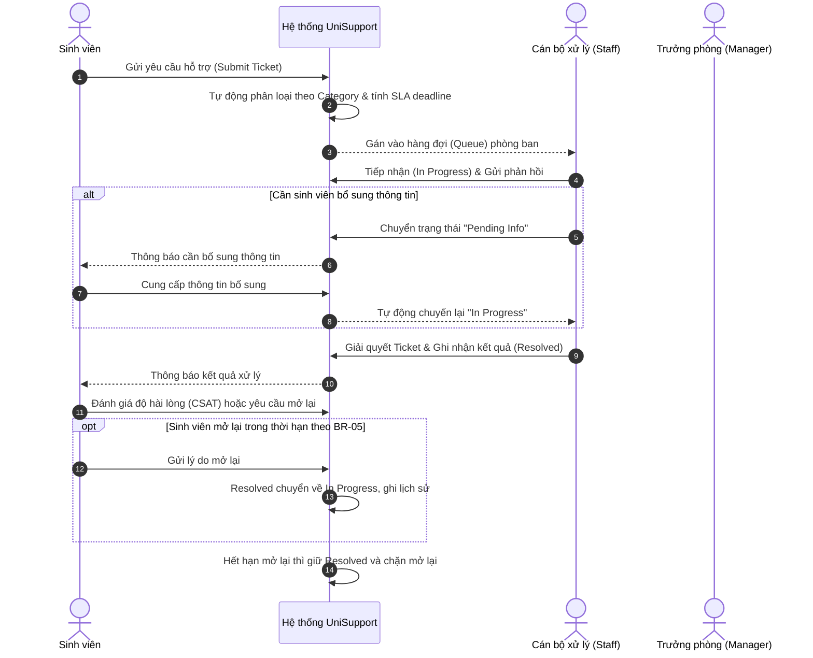

# Quy trình luồng công việc (Workflows)

<!-- Hướng dẫn: phần này dùng làm bằng chứng cho PRD, effort và rủi ro. Giúp làm rõ cách các tác nhân phối hợp xuyên suốt các chức năng của UniSupport. -->

Các luồng dưới đây dùng vòng đời Ticket gốc và các tham số đề xuất trong [Business Rules](../02-domain/business-rules.md). Nhóm xác nhận tham số trước khi lập baseline nghiệm thu.

---

## 1. Luồng Tiếp nhận và Xử lý Ticket (Ticket Handling Workflow)

---

## 2. Luồng Chuyển tiếp Phòng ban (Ticket Escalation & Re-route Workflow)

1. **Nhận diện sai tuyến:** Cán bộ phát hiện Ticket không thuộc phạm vi xử lý của phòng ban mình.
2. **Yêu cầu chuyển tiếp:** Cán bộ chọn phòng ban đích và nhập lý do chuyển giao (Ghi chú nội bộ - Internal Note).
3. **Phê duyệt chuyển phòng:** Trưởng phòng hoặc Cán bộ có thẩm quyền xác nhận chuyển giao.
4. **Kiểm ảnh hưởng SLA:** Áp dụng chính sách chuyển phòng được xác nhận trong BR-03. PM/BA chốt cách giữ hoặc tính lại hạn trước baseline.

---

## 3. Luồng Thu thập Phản hồi và Đánh giá (CSAT Workflow)

1. Khi Ticket chuyển sang trạng thái `Resolved`, sinh viên nhận thông báo kèm khảo sát CSAT (1-5 sao + bình luận).
2. Quy tắc nhận xét cho đánh giá thấp tuân theo FR-STU-05. Phản hồi được xem xét theo quy trình quản lý sản phẩm.
3. Số liệu CSAT được tổng hợp trực tiếp vào [M05 - Dashboard & Report](../03-modules/M05-dashboard-report/prd.md).

---

## 4. Liên kết nghiệp vụ

- Ma trận chuyển trạng thái chi tiết: [02-domain/state-transition.md](../02-domain/state-transition.md)
- Đặc tả chức năng cán bộ: [03-modules/M03-staff-desk/prd.md](../03-modules/M03-staff-desk/prd.md)
- Đặc tả cổng sinh viên: [03-modules/M02-student-portal/prd.md](../03-modules/M02-student-portal/prd.md)
