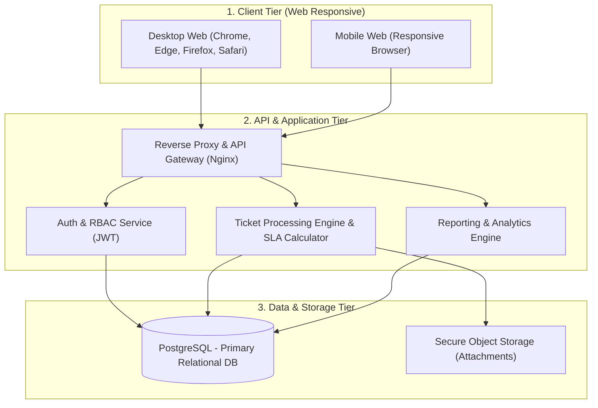

# Kiến trúc hệ thống (System Architecture)

<!-- Hướng dẫn: phần này dùng làm bằng chứng cho PRD, effort và rủi ro. Giảng viên không chấm thiết kế đúng hay sai. Giúp làm rõ cấu trúc kỹ thuật tổng thể của UniSupport. -->

## 1. Mô hình Kiến trúc Tổng thể (High-Level Architecture)

UniSupport được thiết kế theo mô hình kiến trúc phân tầng (Multi-tier Architecture):

---

## 2. Công nghệ cốt lõi (Technology Stack)

- **Frontend:** React / TypeScript, Tailwind CSS (đảm bảo Web Responsive theo [NFR-GLOBAL-03](../05-non-functional-requirements/README.md)).
- **Backend:** Node.js / Express hoặc NestJS, hỗ trợ kiến trúc mô-đun hóa tương ứng 5 module M01–M05.
- **Database:** PostgreSQL quản lý quan hệ thực thể (Users, Tickets, Categories, SLA Policies, Audit Logs).
- **Hạ tầng & Triển khai:** Docker containerization, Nginx reverse proxy, CI/CD tự động trên GitHub Actions.

---

## 3. Môi trường triển khai

1. **Development Environment:** Môi trường cục bộ của lập trình viên, sử dụng mock data.
2. **Staging Environment:** Môi trường kiểm thử giả lập production, dùng cho Integration Test, Security Test và UAT của Aurora University.
3. **Production Environment:** Môi trường chạy chính thức tại hạ tầng máy chủ của Aurora University.
