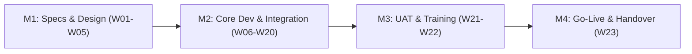

# Master Plan (Kế hoạch tổng thể)

<!-- Hướng dẫn: trang giải thích đi kèm `master-plan.xlsx`. Số liệu (ngày, effort, nguồn lực) chỉ nằm trong Excel; trang này giải thích quyết định. -->

Tài liệu này giải thích các quyết định trong bản kế hoạch 23 tuần của dự án **UniSupport**, bổ trợ cho file chi tiết [master-plan.xlsx](master-plan.xlsx).

---

## Cách chia milestone

Dự án được phân bổ trong 23 tuần với 4 cột mốc chính (Milestones M1–M4):

1. **M1 – Design & Specification Approval (Tuần 5):**
   - **Mục tiêu:** Khóa phạm vi chức năng (PRD), hoàn thiện tài liệu kiến trúc kỹ thuật và hoàn thành bộ giao diện nguyên mẫu (Figma Prototype).
   - **Lý do:** Đảm bảo đại diện Aurora University đã trải nghiệm và xác nhận luồng thao tác trước khi tiến hành viết code, giảm thiểu rủi ro làm lại.
2. **M2 – System Integration & Internal Quality Gate (Tuần 19–20):**
   - **Mục tiêu:** Hoàn thành phát triển 5 phân hệ M01–M05, chạy kiểm thử tích hợp (Integration Test), kiểm thử bảo mật RBAC và kiểm tra hồi quy (Regression Test).
   - **Lý do:** Hệ thống hoạt động trơn tru trên môi trường Staging nội bộ trước khi bàn giao cho người dùng trường kiểm thử.
3. **M3 – User Acceptance Testing (UAT) & Operational Readiness (Tuần 21–22):**
   - **Mục tiêu:** Đại diện cán bộ và sinh viên Aurora University thực hiện kiểm thử chấp nhận người dùng (UAT); tổ chức 02 buổi Workshop hướng dẫn vận hành và gửi thông tin kích hoạt tài khoản.
   - **Lý do:** Đảm bảo hệ thống đáp ứng đúng nhu cầu thực tế và nhân sự trường sẵn sàng tiếp nhận vận hành.
4. **M4 – Production Go-Live & Final Handover (Tuần 23):**
   - **Mục tiêu:** Triển khai chính thức lên máy chủ Production của trường, kiểm tra vận hành thực tế (Smoke Test) và ký biên bản nghiệm thu bàn giao kèm kích hoạt bảo hành 30 ngày.

---

## Phụ thuộc giữa các milestone

- M2 chỉ bắt đầu triển khai code quy mô lớn sau khi Prototype và PRD được phê duyệt tại M1.
- M3 chỉ bắt đầu sau khi hệ thống vượt qua Quality Gate M2 với 0 lỗi Critical/High tồn đọng.
- M4 chỉ diễn ra khi có biên bản xác nhận nghiệm thu UAT của Aurora University tại M3.

---

## Effort cho test, regression và sửa lỗi

- Hoạt động kiểm thử được bố trí song song với quá trình phát triển (kiểm thử từng chức năng theo Sprint).
- Dành riêng 2 tuần ở cuối M2 và 1 tuần ở M3 cho hoạt động Regression Testing, đảm bảo các bản sửa lỗi không làm ảnh hưởng các chức năng đã hoàn thành trước đó.
- Nhân lực QA/QC Engineer phụ trách chuyên trách 100% thời gian cho công tác kiểm soát chất lượng.

---

## Dự phòng cho thay đổi và rủi ro

- Kế hoạch dự phòng 10-15% thời gian đệm trong các tuần 19-20 để xử lý các vấn đề phát sinh từ kiểm thử tích hợp.
- Mọi yêu cầu thay đổi (Change Request) phát sinh từ phía khách hàng phải được đánh giá tác động riêng và có thể được xếp vào các bản phát hành tiếp theo (Release 1.x / 2.0).

---

## Cách nhận feedback của client sau mỗi milestone

- Tại cuối mỗi Milestone (M1, M2, M3), Project Manager gửi Báo cáo Cột mốc kèm đường dẫn sản phẩm kiểm tra (Figma prototype, Staging demo URL).
- Tổ chức buổi họp demo trực tiếp trên Google Meet để lắng nghe phản hồi.
- Khách hàng phản hồi bằng văn bản hoặc ghi nhận vào biên bản cuộc họp trong vòng 3 ngày làm việc.

---

## Thay đổi kế hoạch

Kế hoạch cơ sở được lưu trữ trong [master-plan.xlsx](master-plan.xlsx). Mọi thay đổi về thời hạn, phạm vi hoặc ngân sách sau khi đã chốt cơ sở đều phải được ghi nhận vào sheet Change Log của file Excel và thông qua quy trình [11-governance/change-control.md](../11-governance/change-control.md).
