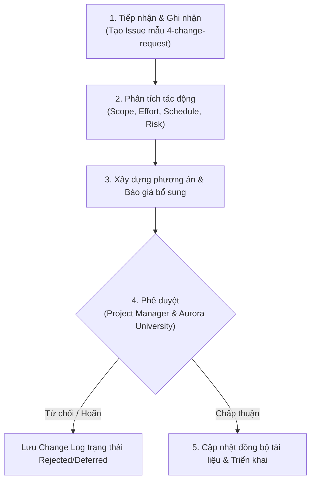

# Quy trình kiểm soát thay đổi (Change Request Process)

<!-- Hướng dẫn: CR thực tế tạo bằng GitHub Issue theo mẫu "Change request", mã `CR-xx`. Quy trình này kiểm soát chặt chẽ các thay đổi nhằm bảo vệ phạm vi, ngân sách và lịch trình 23 tuần của UniSupport. -->

---

## Các bước thực hiện

Quy trình Change Request (CR) gồm 5 bước chuẩn hóa:

1. **Tiếp nhận & Ghi nhận:** Yêu cầu thay đổi được tạo qua GitHub Issue bằng mẫu `4-change-request.md`. Ghi rõ: người yêu cầu, mô tả chi tiết thay đổi và lý do đề xuất.
2. **Phân tích tác động:** PM phối hợp cùng Technical Lead và BA đánh giá toàn diện ảnh hưởng tới kiến trúc, cơ sở dữ liệu, các chức năng phụ thuộc và rủi ro phát sinh.
3. **Đánh giá phương án & Chi phí:** Tính toán chi tiết số giờ công (effort) tăng thêm, chi phí bổ sung (nếu có) và tác động lên đường găng của kế hoạch 23 tuần.
4. **Phê duyệt chính thức:** PM gửi văn bản đề xuất giải pháp cho người có thẩm quyền của Aurora University. Hai bên thống nhất phê duyệt bằng văn bản.
5. **Cập nhật đồng bộ & Triển khai:** Chỉ sau khi được duyệt, PM mới cập nhật tài liệu dự án, tạo task trên GitHub và phân công đội ngũ triển khai.

---

## Đánh giá tác động

Mỗi Change Request bắt buộc phải được đánh giá trên 6 khía cạnh:
- **Phạm vi (Scope):** Tính năng này có thuộc phạm vi Release 1.0 không hay nên dời sang Release 1.x / 2.0?
- **Nỗ lực (Effort):** Số giờ công (man-hours) của từng vai trò (BA, FE, BE, QA, DevOps) cần thêm.
- **Chi phí (Cost):** Đơn giá giờ công phát sinh và tác động tới tổng giá trị hợp đồng.
- **Tiến độ (Timeline):** Có ảnh hưởng một trong các mốc MS-01 đến MS-08 hoặc hạn bàn giao tuần 23 không?
- **Rủi ro (Risk):** Ảnh hưởng đến tính toàn vẹn dữ liệu, hiệu năng hoặc an ninh thông tin.
- **Kiểm thử (Acceptance & Test):** Số kịch bản kiểm thử (Test Scenarios) cần viết mới hoặc sửa đổi.

---

## Người duyệt

| Loại thay đổi | Người duyệt | Hình thức phê duyệt |
| --- | --- | --- |
| **Thay đổi In-Scope, Ngân sách hoặc Cột mốc bàn giao (MS-01 đến MS-08)** | Đại diện có thẩm quyền của Aurora University & Project Manager | Văn bản ký xác nhận hoặc Email chính thức |
| **Thay đổi giải pháp kỹ thuật, thư viện, kiến trúc nội bộ** | Technical Lead | Phê duyệt trên GitHub Pull Request / Architecture review |
| **Điều chỉnh phân bổ nhân sự, thứ tự task nội bộ (không trễ mốc)** | Project Manager | Cập nhật trên GitHub Projects / Milestone board |
| **Thay đổi nhỏ về nhãn hiển thị, tinh chỉnh giao diện nhỏ (UI tweak)** | UI/UX Designer & BA / PM | Xác nhận qua Issue comment |

---

## Cập nhật đồng bộ khi CR được duyệt

Khi một Change Request được phê duyệt, các tài liệu sau bắt buộc phải được cập nhật đồng thời:
1. **Đặc tả yêu cầu (PRD):** Cập nhật tiêu chí nghiệm thu (AC) và mô tả chức năng trong `docs/03-modules/Mxx-*/prd.md`.
2. **Báo giá dự án:** Ghi nhận hạng mục bổ sung trong `docs/08-project/quotation.xlsx` (nếu có phát sinh chi phí).
3. **Kế hoạch tổng thể:** Ghi nhận vào sheet `Change Log` của `docs/08-project/master-plan.xlsx` (phiên bản, ngày, mã CR, nội dung thay đổi) và cập nhật Gantt chart nếu có điều chỉnh ngày.
4. **Kịch bản kiểm thử:** Bổ sung/sửa đổi test scenario trong `docs/06-acceptance/test-scenarios.md` và `traceability-matrix.md`.
5. **GitHub Issues:** Cập nhật nhãn `change-request` và liên kết với Milestone tương ứng.
