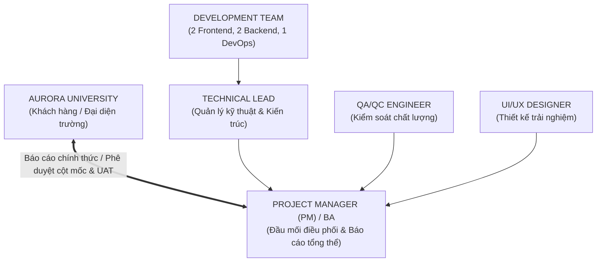

# Cơ chế báo cáo dự án (Reporting Governance)

Tài liệu này xác định cơ cấu quản trị, các tuyến báo cáo và quy trình thông tin liên lạc giữa Đội dự án UniSupport và Khách hàng (Aurora University).

---

## 1. Cơ cấu Quản trị và Tuyến Báo cáo



- **Tuyến kỹ thuật nội bộ:** Đội ngũ Frontend, Backend và DevOps báo cáo trực tiếp cho Technical Lead.
- **Tuyến tổng hợp dự án:** Technical Lead, QA/QC và UI/UX báo cáo cho Project Manager.
- **Tuyến đối ngoại:** PM là đầu mối duy nhất trao đổi chính thức với đại diện Aurora University.

---

## 2. Bảng Quy trình Báo cáo

| Báo cáo | Ai lập | Gửi cho ai | Khi nào | Nội dung chính | Lưu ở |
| --- | --- | --- | --- | --- | --- |
| **Báo cáo hằng ngày (Daily Standup)** | Thành viên thực hiện $\rightarrow$ Tech Lead & PM | Nội bộ Đội dự án | 08:45–09:00 các ngày làm việc | 4 câu hỏi: Việc đã làm, việc sẽ làm, vướng mắc (blocker), cần ai hỗ trợ | GitHub Issue comments & Biên bản họp Meet |
| **Báo cáo tuần (Weekly Report)** | Project Manager | Đội dự án & Đại diện trường | 15:00–15:45 thứ Sáu hằng tuần | Tiến độ hoàn thành, giờ công thực tế, rủi ro, kế hoạch tuần tới | Email / Thư mục `docs/11-governance/` |
| **Báo cáo tháng (Monthly Progress)** | Project Manager | Đại diện Aurora University | Cuối mỗi tháng | Tổng hợp tiến độ lũy kế, ngân sách, chỉ số EVM (SPI/CPI), rủi ro và các quyết định cần trường phê duyệt | Báo cáo văn bản chính thức |
| **Báo cáo cột mốc (Milestone Report)** | Project Manager | Đại diện Aurora University | Khi kết thúc M1 (W05), M2 (W20), M3 (W22), M4 (W23) | Hồ sơ kết quả nghiệm thu mốc, biên bản demo, kết quả kiểm thử và đề nghị phê duyệt | Kèm biên bản nghiệm thu mốc |
| **Báo cáo khẩn cấp (Emergency Alert)** | Người phát hiện $\rightarrow$ Tech Lead & PM | PM $\rightarrow$ Aurora University (nếu ảnh hưởng cam kết) | Ngay khi phát hiện sự cố nghiêm trọng | Sự cố hệ thống, rò rỉ dữ liệu hoặc blocker làm trễ đường găng; biện pháp xử lý tức thời | Tin nhắn khẩn cấp & GitHub Issue |
| **Báo cáo tổng kết (Final Report)** | Project Manager | Đại diện Aurora University & Ban Giám Hiệu | Kết thúc Tuần 23 sau Go-Live | Tổng kết toàn diện dự án, đối chiếu cam kết trong Proposal, bài học kinh nghiệm và bàn giao bảo hành | Hồ sơ nghiệm thu cuối cùng |

---

## 3. Mẫu Báo cáo Tuần tóm tắt (Weekly Report Template)

```markdown
### BÁO CÁO TUẦN [Số tuần] - DỰ ÁN UNISUPPORT
- **Thời gian:** [Từ ngày... đến ngày...]
- **Người lập:** Project Manager
- **Trạng thái chung:** [Xanh / Vàng / Đỏ]

1. Công việc đã hoàn thành trong tuần:
   - [Mã Issue/Task] - [Tên công việc] - [Người thực hiện]
2. Công việc đang triển khai:
   - [Mã Issue/Task] - [Tiến độ %] - [Dự kiến xong]
3. Vướng mắc & Rủi ro phát sinh:
   - [Vấn đề] - [Mức ảnh hưởng] - [Đề xuất hướng xử lý]
4. Kế hoạch trọng tâm tuần tiếp theo:
   - [Mục tiêu và task chính]
5. Nội dung cần Aurora University phản hồi/phê duyệt:
   - [Nội dung và hạn chót phản hồi]
```
