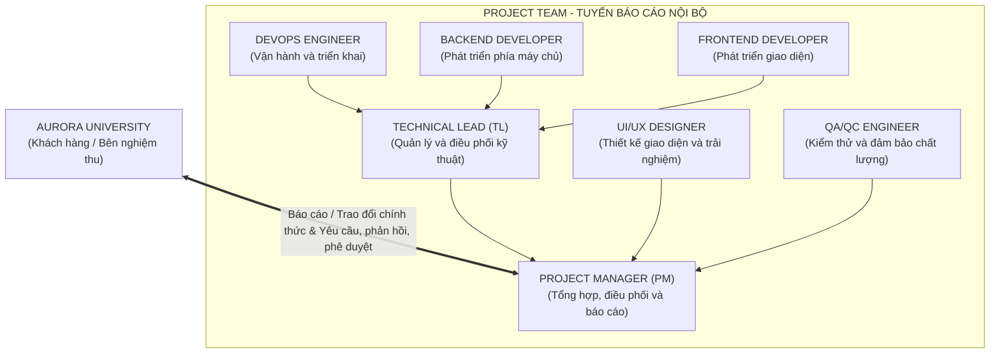

# PROJECT GOVERNANCE & MONITORING
## UNISUPPORT - STUDENT SUPPORT MANAGEMENT SYSTEM

---

## 1. Cơ cấu quản trị và tuyến báo cáo

### Mục đích và phạm vi
Phần này quy định cơ cấu quản lý, trách nhiệm và tuyến báo cáo của dự án **UniSupport**. Thông tin về tiến độ, giờ công, chi phí, chất lượng và mức độ đáp ứng cam kết được tổng hợp từ người thực hiện qua cấp phụ trách chuyên môn đến **Project Manager (PM)**, rồi báo cáo **Aurora University**. Cách tổ chức này giúp phát hiện sớm sai lệch, rủi ro và vấn đề cần quyết định.

---

### 1.1. Mô tả cơ cấu quản trị

- **Cấp 1 trực tiếp thực hiện công việc:** Hai Frontend Developer, hai Backend Developer và một DevOps Engineer. Các thành viên này cập nhật công việc cho Technical Lead.
- **Cấp 2 phụ trách chuyên môn:** 
  - **Technical Lead:** Tổng hợp kỹ thuật và báo cáo PM.
  - **QA/QC Engineer:** Báo cáo kết quả kiểm thử, lỗi và chất lượng cho PM.
  - **UI/UX Designer:** Báo cáo thiết kế và tiến độ cho PM.
- **Cấp 3 là PM (Project Manager):** Đồng thời đảm nhiệm công việc **Business Analyst (BA)** theo Team Charter. PM theo dõi yêu cầu, phạm vi, thay đổi và tổng hợp tình hình toàn dự án.
- **Cấp 4 là Aurora University:** Khách hàng cung cấp yêu cầu, phản hồi và phê duyệt các cột mốc, kết quả nghiệm thu thuộc cam kết dự án. PM là đầu mối trao đổi chính thức giữa Project Team và Aurora University.

---

### 1.2. Bảng trách nhiệm và báo cáo theo từng cấp

| Cấp | Nhân lực và vai trò | Tuyến báo cáo | Trách nhiệm và công việc phải báo cáo |
| :--- | :--- | :--- | :--- |
| **Cấp 1** Thực hiện dự án | Frontend Developer (2 người: Senior, Junior) | Báo cáo Technical Lead. | Thực hiện giao diện theo công việc được giao; cập nhật tiến độ, giờ công, kết quả triển khai, lỗi, phụ thuộc và vướng mắc. |
| | Backend Developer (2 người: Senior, Junior) | Báo cáo Technical Lead. | Thực hiện API, cơ sở dữ liệu và logic nghiệp vụ; cập nhật tiến độ, giờ công, kết quả, lỗi tích hợp và vướng mắc. |
| | DevOps Engineer (1 người) | Báo cáo Technical Lead. | Quản lý môi trường và triển khai theo phân công; cập nhật tình trạng môi trường, tiến độ, giờ công, sự cố và chi phí hạ tầng phát sinh. |
| **Cấp 2** Phụ trách chuyên môn | Technical Lead / Solution Architect (1 người) | Tổng hợp từ Frontend, Backend, DevOps; báo cáo PM. | Theo dõi kiến trúc, mã nguồn, tích hợp và phụ thuộc kỹ thuật; tổng hợp tiến độ, giờ công, lỗi kỹ thuật, rủi ro, phương án xử lý và tác động đến kế hoạch. |
| | QA/QC Engineer / QA Tester (1 người) | Báo cáo PM; phối hợp Technical Lead xử lý lỗi. | Lập và thực hiện kiểm thử; báo cáo kết quả, bằng chứng, lỗi tồn đọng, mức đáp ứng tiêu chí và đề xuất kiểm thử lại. |
| | UI/UX Designer (1 người) | Báo cáo PM; phối hợp Technical Lead khi triển khai thiết kế. | Thiết kế wireframe, prototype và giao diện; báo cáo tiến độ, giờ công, phiên bản thiết kế, phản hồi và nội dung cần xác nhận. |
| **Cấp 3** Quản lý dự án | Project Manager / Business Analyst | Nhận báo cáo từ Technical Lead, QA/QC và UI/UX; báo cáo, trao đổi chính thức với Aurora University. | Tiếp nhận và làm rõ yêu cầu; quản lý phạm vi, thay đổi, kế hoạch và nguồn lực; tổng hợp tiến độ, giờ công, chi phí, chất lượng, rủi ro, quyết định cần khách hàng phản hồi và tình trạng cột mốc. |
| **Cấp 4** Khách hàng | Aurora University | Trao đổi yêu cầu, phản hồi và kết quả phê duyệt qua PM. | Cung cấp thông tin nghiệp vụ; phản hồi yêu cầu làm rõ, thay đổi và báo cáo dự án; phê duyệt cột mốc, tham gia demo, đánh giá nghiệm thu và nhận bàn giao theo Proposal. |

---

### 1.3. Sơ đồ cơ cấu quản trị và tuyến báo cáo

*Chú thích:*
- **Mũi tên liền:** Thể hiện tuyến báo cáo nội bộ từ người thực hiện lên cấp tổng hợp.
- **Mũi tên đứt (hoặc trao đổi hai chiều):** Thể hiện báo cáo, yêu cầu và phản hồi giữa PM với Aurora University.

---

### 1.4. Nguyên tắc quản trị và báo cáo

- **Tuyến báo cáo thống nhất:** Mỗi thành viên cập nhật qua tuyến được chỉ định. Frontend, Backend và DevOps gửi thông tin cho Technical Lead để tổng hợp; PM không yêu cầu báo cáo trùng cùng nội dung qua nhiều tuyến, trừ trường hợp cần làm rõ hoặc xử lý khẩn.
- **Thông tin có thể đối chiếu:** Báo cáo gắn với task và kỳ cập nhật; thể hiện tiến độ, đầu ra, giờ công thực tế so với kế hoạch, ETA, blocker và hỗ trợ cần thiết. Chi phí phát sinh phải ghi căn cứ; PM tổng hợp khi có dữ liệu, không suy chi phí chỉ từ phần trăm task hoàn thành.
- **Xử lý đúng cấp:** Thành viên báo vướng mắc kỹ thuật cho Technical Lead; Technical Lead xử lý chuyên môn và báo PM khi ảnh hưởng tiến độ, nguồn lực hoặc phạm vi. PM điều phối công việc dự án; vấn đề thay đổi cam kết với Aurora University được hai bên xem xét và thống nhất qua PM.
- **Kiểm soát phê duyệt:** Yêu cầu ngoài phạm vi và thay đổi cam kết về thời gian hoặc chi phí phải được đánh giá tác động và được Project Team cùng Aurora University thống nhất trước khi triển khai. Kết quả review chuyên môn không thay cho phê duyệt cột mốc hoặc nghiệm thu của khách hàng.
- **Một đầu mối khách hàng:** PM là đầu mối chính thức với Aurora University. Thành viên có thể tham gia làm rõ nghiệp vụ hoặc kỹ thuật theo điều phối của PM; không tự cam kết thêm chức năng, hạn bàn giao, chi phí hoặc kết quả nghiệm thu.
- **Báo sớm và lưu quyết định:** Báo vướng mắc, rủi ro và sai lệch ngay khi nhận biết; không đợi đến hạn. Technical Lead tổng hợp kỹ thuật, PM tổng hợp dự án trong báo cáo tuần theo Team Charter. Vấn đề khẩn được báo ngay PM hoặc Technical Lead; kết quả xử lý được ghi cùng người quyết định, ngày và hành động tiếp theo.
- **Không đồng nhất báo cáo và hoàn thành:** Người thực hiện cung cấp đầu ra; cấp giám sát kiểm tra/tổng hợp; người có thẩm quyền xác nhận hoặc phê duyệt theo loại quyết định. Chỉ cập nhật hoàn thành khi có bằng chứng phù hợp với tiêu chí; báo cáo đã gửi không đồng nghĩa công việc đã được nghiệm thu.

---

### 1.5. Luồng thông tin từ tiếp nhận đến hoàn thành

1. **Tiếp nhận:** Aurora University gửi yêu cầu, phản hồi hoặc nội dung cần xác nhận cho PM. PM ghi nhận, làm rõ yêu cầu với chức năng BA, đối chiếu phạm vi và kế hoạch; yêu cầu mới hoặc thay đổi được đánh giá tác động trước khi giao thực hiện.
2. **Phân công và xử lý:** PM chuyển công việc kỹ thuật cho Technical Lead để phân công Frontend, Backend và DevOps; giao công việc thiết kế cho UI/UX và kiểm thử cho QA/QC. Người thực hiện cập nhật tiến độ, giờ công, đầu ra và vướng mắc qua tuyến báo cáo trong bảng; Technical Lead tổng hợp phần kỹ thuật cho PM.
3. **Kiểm tra và hoàn thành:** Technical Lead review kết quả kỹ thuật; QA/QC kiểm thử và ghi nhận lỗi, bằng chứng; UI/UX phản ánh kết quả thiết kế và các nội dung cần điều chỉnh. PM đối chiếu kết quả với yêu cầu và tiêu chí đã thống nhất, tổng hợp phần hoàn thành và phần còn tồn.
4. **Báo cáo và phản hồi:** PM gửi Aurora University tình hình tiến độ, giờ công, chi phí, chất lượng, rủi ro và nội dung cần khách hàng quyết định. Aurora University phản hồi hoặc phê duyệt cột mốc, đánh giá nghiệm thu theo Proposal; PM chuyển kết quả phản hồi xuống đúng vai trò để tiếp tục xử lý hoặc bàn giao.

---

## 2. Quy trình báo cáo

| Loại báo cáo | Thời điểm báo cáo | Người tạo báo cáo và người tiếp nhận | Hình thức báo cáo |
| :--- | :--- | :--- | :--- |
| **Báo cáo hằng ngày** | Trong ngày làm việc khi có kết quả hoặc vướng mắc; chốt trạng thái vào cuối ngày. | Frontend, Backend, DevOps $\rightarrow$ Technical Lead; Technical Lead, QA/QC, UI/UX $\rightarrow$ PM. | Cập nhật công việc trên GitHub Project/Issue: trạng thái, kết quả, giờ công và vướng mắc. Vấn đề cần xử lý ngay được báo qua kênh trao đổi nội bộ. |
| **Báo cáo tuần** | Trước cuộc họp tuần; bổ sung kết quả và quyết định sau cuộc họp. | Technical Lead, QA/QC, UI/UX $\rightarrow$ PM; PM $\rightarrow$ Aurora University. | Báo cáo tổng hợp việc hoàn thành, việc đang làm, tiến độ, giờ công, chi phí phát sinh, lỗi, rủi ro và quyết định cần phản hồi; lưu kèm biên bản họp. |
| **Báo cáo tháng** | Cuối mỗi tháng, dựa trên các báo cáo tuần trong tháng. | PM $\rightarrow$ Aurora University. | Báo cáo tổng hợp tiến độ, giờ công, chi phí, chất lượng, thay đổi và dự báo các cột mốc tiếp theo; gửi bằng văn bản hoặc email. |
| **Báo cáo các cột mốc** | Khi kết quả cột mốc sẵn sàng để xem xét: M1 (Tuần 5); M2 (Tuần 19-20); M3 (Tuần 21-22); M4 (Tuần 23). | PM tổng hợp từ các vai trò chuyên môn $\rightarrow$ Aurora University. | Hồ sơ kết quả cột mốc kèm demo, kết quả kiểm thử và tài liệu liên quan; ghi nhận phản hồi, nội dung cần sửa và kết quả phê duyệt bằng văn bản. |
| **Báo cáo khẩn cấp** | Ngay khi phát hiện sự cố, rủi ro hoặc vướng mắc có thể ảnh hưởng hệ thống, dữ liệu, đường găng hoặc cột mốc. | Người phát hiện $\rightarrow$ Technical Lead hoặc PM; PM $\rightarrow$ Aurora University (nếu ảnh hưởng cam kết với khách hàng). | Thông báo nhanh qua kênh liên lạc nội bộ; sau đó ghi lại sự việc, mức ảnh hưởng, biện pháp xử lý, người phụ trách và kết quả trên công cụ theo dõi hoặc email. |
| **Báo cáo tổng kết** | Sau khi hoàn tất nghiệm thu và bàn giao dự án. | PM $\rightarrow$ Aurora University. | Báo cáo kết quả so với phạm vi, tiến độ, chi phí và chất lượng đã cam kết; kèm tình trạng cột mốc, vấn đề còn tồn, tài liệu bàn giao và bài học kinh nghiệm. |

---

### 2.1. Báo cáo họp hằng ngày

- **Mục đích:** Buổi họp hằng ngày giúp PM nắm kết quả đã hoàn thành, công việc tiếp theo, mức chênh lệch so với kế hoạch và các vướng mắc cần xử lý. Đây là cuộc họp điều phối ngắn; vấn đề cần phân tích sâu được chuyển sang trao đổi riêng sau cuộc họp để không kéo dài thời gian của cả nhóm.
- **Thời gian & Hình thức:** Mỗi ngày làm việc, các thành viên cập nhật Issue trước **08:40**. PM chủ trì họp trên Google Meet từ **08:45 đến 09:00** (tối đa 15 phút), trước khi bắt đầu khung giờ phối hợp chung lúc **09:00**. PM dùng cùng một đường dẫn họp cho nhóm và ghi các quyết định, người phụ trách, thời hạn xử lý vào biên bản họp.
- **Cập nhật trước cuộc họp:** Mỗi thành viên kiểm tra các Issue mình phụ trách, cập nhật trạng thái trên GitHub Project và ghi nhận kết quả công việc trong đúng Issue.
- **Ghi giờ công:** Trong phần bình luận của từng Issue, người thực hiện ghi theo mẫu: *Ngày; số giờ thực tế đã làm trên Issue trong ngày; kết quả/đường dẫn đầu ra; phần việc còn lại hoặc thời điểm dự kiến hoàn thành; vướng mắc và hỗ trợ cần thiết*. Số giờ là thời gian đã sử dụng, không phải số giờ ước tính còn lại. Việc ghi theo Issue giúp Technical Lead và PM đối chiếu giờ công với kế hoạch, nhận biết công việc tiêu tốn nhiều nguồn lực, dự báo tiến độ và tổng hợp chi phí có căn cứ.
- **Nội dung trả lời trong cuộc họp:** Mỗi thành viên trả lời ngắn gọn, tập trung vào 4 câu hỏi:
  1. Từ lần cập nhật trước, tôi đã hoàn thành việc gì? Kết quả nằm ở Issue hoặc đầu ra nào?
  2. Hôm nay tôi sẽ làm việc gì? Dự kiến hoàn thành khi nào?
  3. Tôi đang gặp vướng mắc nào? Vướng mắc đó ảnh hưởng đến tiến độ hoặc công việc liên quan ra sao?
  4. Tôi cần ai hỗ trợ hoặc cần quyết định gì, trước thời điểm nào?
- **Xử lý vướng mắc:** PM ghi nhận từng vướng mắc cùng Issue, người chịu trách nhiệm và thời điểm phản hồi. Vướng mắc kỹ thuật được giao Technical Lead xử lý với các thành viên liên quan; vướng mắc về ưu tiên, nguồn lực hoặc tiến độ do PM điều phối. Nếu vấn đề ảnh hưởng phạm vi, chi phí, thời hạn hoặc cam kết với Aurora University, PM tổng hợp tác động và trao đổi chính thức với khách hàng theo quy trình thay đổi. Các sự cố khẩn cấp phải được báo ngay khi phát hiện, không chờ đến cuộc họp sáng hôm sau.
- **Vắng họp:** Thành viên thông báo cho PM trước cuộc họp nếu có thể, vẫn cập nhật Issue trước 08:40 và gửi 4 nội dung trên bằng kênh trao đổi nội bộ. Nếu nội dung phụ trách cần trình bày, thành viên chỉ định người thay thế. Sau cuộc họp, người vắng mặt đọc biên bản, xác nhận các việc được giao và phản hồi cho PM trong ngày làm việc.

---

### 2.2. Báo cáo tuần

- **Thời gian và mục đích:** PM chủ trì cuộc họp tuần trên Google Meet từ **15:00 đến 15:45 thứ Sáu hằng tuần**. Cuộc họp dùng để đối chiếu kết quả với kế hoạch tuần, nhận diện công việc trễ hoặc có rủi ro, thống nhất việc ưu tiên và người chịu trách nhiệm cho tuần tiếp theo.
- **Trong cuộc họp:** Technical Lead báo cáo tiến độ kỹ thuật và phụ thuộc; QA/QC báo cáo kết quả kiểm thử và lỗi còn tồn; UI/UX báo cáo phần thiết kế; các thành viên nêu ngắn gọn kết quả, giờ công, vướng mắc và hỗ trợ cần thiết. PM tổng hợp chênh lệch tiến độ, chi phí và cam kết, quyết định các việc thuộc phạm vi điều phối của mình và ghi lại vấn đề cần Aurora University phản hồi.
- **Sau cuộc họp:** PM hoàn thiện biên bản với quyết định, người phụ trách và hạn xử lý; cập nhật kế hoạch trên GitHub Project. Các thành viên cập nhật Issue được giao, thực hiện quyết định liên quan và báo ngay cho PM nếu có trở ngại ảnh hưởng đến hạn đã thống nhất.

---

### 2.3. Báo cáo tháng cho khách hàng

PM lập và gửi báo cáo vào cuối mỗi tháng cho Aurora University. Báo cáo cho thấy dự án đang đáp ứng kế hoạch và cam kết đến đâu, xu hướng của tháng tiếp theo và những nội dung cần khách hàng phản hồi hoặc quyết định. Số liệu được tổng hợp từ Issue, GitHub Project, giờ công và kết quả kiểm thử đã ghi nhận.

| Thành phần | Chức năng |
| :--- | :--- |
| **Tóm tắt tình hình** | Nêu kết quả chính, trạng thái chung và vấn đề quan trọng nhất để khách hàng nắm nhanh tình hình dự án. |
| **Tiến độ và cột mốc** | Đối chiếu công việc đã hoàn thành với kế hoạch; chỉ rõ cột mốc đúng hạn, có nguy cơ trễ và tác động dự kiến. |
| **Giờ công và chi phí** | Tổng hợp giờ thực tế, phần chênh lệch so với kế hoạch và chi phí phát sinh có căn cứ để theo dõi việc sử dụng nguồn lực. |
| **Chất lượng** | Tóm tắt kết quả kiểm thử, lỗi còn mở và mức sẵn sàng của đầu ra; cho biết vấn đề chất lượng nào cần xử lý trước cột mốc tiếp theo. |
| **Rủi ro, vấn đề và thay đổi** | Nêu vấn đề đang ảnh hưởng dự án, biện pháp xử lý, người phụ trách và tác động của yêu cầu thay đổi tới phạm vi, tiến độ hoặc chi phí. |
| **Nội dung cần Aurora University phản hồi** | Ghi rõ nội dung cần xác nhận hoặc phê duyệt, tác động nếu chậm phản hồi và thời điểm cần quyết định. |
| **Kế hoạch tháng tiếp theo** | Xác định đầu ra, cột mốc, việc ưu tiên và hỗ trợ cần thiết để khách hàng theo dõi cam kết kỳ tới. |

---

### 2.4. Báo cáo các cột mốc

Khi đầu ra của một cột mốc sẵn sàng, PM gửi Aurora University hồ sơ để đối chiếu với cam kết và ghi nhận kết quả phê duyệt. Báo cáo tập trung vào kết quả có thể kiểm tra, phần chưa đạt và quyết định khách hàng cần đưa ra.

| Thành phần | Nội dung và chức năng |
| :--- | :--- |
| **Thông tin cột mốc** | Nêu mã mốc, thời điểm theo kế hoạch, đầu ra và điều kiện đã cam kết; xác định chính xác nội dung đang đề nghị khách hàng xem xét. |
| **Kết quả bàn giao** | Liệt kê đầu ra, phiên bản và đường dẫn tài liệu hoặc bản demo; phân biệt phần đã hoàn thành và phần còn thiếu. |
| **Đối chiếu tiêu chí** | Ghi từng tiêu chí của mốc cùng kết quả đạt/chưa đạt và căn cứ đánh giá; giúp khách hàng kiểm tra mức đáp ứng cam kết. |
| **Bằng chứng kiểm tra** | Đính kèm prototype, biên bản demo, báo cáo kiểm thử hoặc tài liệu bàn giao phù hợp với mốc; cho phép kiểm chứng kết quả đã nêu. |
| **Thay đổi và tác động** | Tóm tắt thay đổi đã được hai bên thống nhất và tác động còn lại tới phạm vi, tiến độ hoặc chi phí của mốc tiếp theo. |
| **Đề nghị phản hồi** | Yêu cầu Aurora University xác nhận kết quả hoặc nêu nội dung chưa đáp ứng bằng văn bản; ghi rõ việc cần quyết định và bước xử lý tiếp theo. |

**Bằng chứng theo mốc:**
- **M1:** Prototype và phạm vi được khóa.
- **M2:** Kết quả tích hợp và kiểm thử hệ thống.
- **M3:** Hồ sơ xác nhận sẵn sàng Go-live.
- **M4:** Kết quả triển khai, biên bản bàn giao hệ thống và tài liệu.

*PM chỉ đưa vào báo cáo những đầu ra đã có bằng chứng kiểm tra.*

---

### 2.5. Báo cáo khẩn cấp

- **Mục đích:** Báo cáo khẩn cấp giúp nhóm phản ứng ngay với sự cố hoặc rủi ro có thể ảnh hưởng hệ thống, dữ liệu, đường găng hay cam kết dự án. Người phát hiện báo ngay khi nhận biết, không chờ cuộc họp hằng ngày hoặc báo cáo tuần, tháng.
- **Nội dung bắt buộc:** Báo cáo nêu thời điểm phát hiện; sự việc và Issue hoặc thành phần bị ảnh hưởng; bằng chứng hiện có; tác động đã biết tới người dùng, dữ liệu, tiến độ hoặc chi phí; biện pháp đã thực hiện; người đang xử lý; hỗ trợ hoặc quyết định cần nhận; thời điểm cập nhật tiếp theo. Thông tin chưa xác minh được ghi rõ là đang kiểm tra, không trình bày như kết luận.
- **Kênh gửi và thời hạn phản hồi:** Người phát hiện nhắn vào kênh trao đổi nội bộ của nhóm và gọi trực tiếp Technical Lead hoặc PM; sau khi xử lý bước đầu, ghi lại diễn biến và quyết định trong Issue liên quan. Trong khung giờ phối hợp chung, người nhận xác nhận đã tiếp nhận và chỉ định hướng xử lý ban đầu trong 30 phút. Ngoài khung giờ này, với sự cố nghiêm trọng, người phát hiện gọi trực tiếp PM và Technical Lead; người nhận xác nhận ngay khi tiếp nhận cuộc gọi.
- **Xử lý khi ảnh hưởng cam kết khách hàng:** PM phối hợp Technical Lead xác định tác động và biện pháp khống chế, cập nhật người phụ trách cùng thời hạn xử lý. Nếu phạm vi, thời hạn, chi phí, chất lượng bàn giao hoặc an toàn dữ liệu của Aurora University bị ảnh hưởng, PM chủ động thông báo chính thức cho trường qua email, nêu sự việc, tác động sơ bộ, biện pháp đang thực hiện và thời điểm cập nhật tiếp. Mọi điều chỉnh cam kết được đánh giá qua Change Request và chỉ áp dụng sau khi hai bên thống nhất.

**Các tình huống phải báo ngay:**
1. Hệ thống Production hoặc dịch vụ chính ngừng hoạt động, gây gián đoạn sử dụng.
2. Mất, lộ, truy cập trái phép hoặc nghi ngờ xâm phạm dữ liệu và bảo mật.
3. Vướng mắc chặn công việc trên đường găng hoặc khiến cột mốc có nguy cơ trễ.
4. Lỗi tích hợp hoặc lỗi nghiêm trọng làm đầu ra không đáp ứng tiêu chí đã thống nhất.
5. Yêu cầu khẩn cấp từ Aurora University có thể làm thay đổi phạm vi, thời hạn hoặc chi phí.

---

### 2.6. Báo cáo tổng kết

Tại thời điểm bàn giao, PM lập báo cáo tổng kết cho Aurora University. Báo cáo đối chiếu kết quả thực hiện với kế hoạch đã thống nhất, xác nhận những gì được bàn giao và chỉ rõ trách nhiệm đối với phần việc còn tồn. Các số liệu và kết luận phải có nguồn đối chiếu từ kế hoạch, Issue, kết quả kiểm thử và biên bản liên quan.

| Nội dung | Thông tin cần trình bày |
| :--- | :--- |
| **Phạm vi và đầu ra** | Đối chiếu từng đầu ra đã cam kết với kết quả bàn giao; nêu phần đã hoàn thành, phần chưa hoàn thành và tài liệu hoặc phiên bản làm bằng chứng. |
| **Tiến độ dự án** | So sánh thời điểm kế hoạch và thực tế của các cột mốc; giải thích chênh lệch và tác động đến việc bàn giao. |
| **Giờ công và chi phí** | Tổng hợp giờ công, chi phí thực tế đã ghi nhận so với kế hoạch; nêu nguyên nhân chênh lệch và các thay đổi đã được hai bên thống nhất. |
| **Kiểm thử và nghiệm thu** | Tóm tắt kết quả kiểm thử, lỗi còn mở và kết quả xác nhận sẵn sàng nội bộ; ghi riêng tình trạng nghiệm thu, phản hồi của Aurora University. |
| **Bài học kinh nghiệm** | Ghi cách làm hiệu quả, sai lệch hoặc nguyên nhân gốc gây khó khăn và cải tiến nhóm sẽ áp dụng cho dự án sau. |
| **Vấn đề còn tồn đọng** | Liệt kê từng vấn đề, mức ảnh hưởng, người phụ trách, hạn xử lý và cách theo dõi sau bàn giao; không ghi chung chung là “sẽ xử lý". |
| **Xác nhận bàn giao** | Liệt kê hệ thống, mã nguồn, tài liệu và hướng dẫn đã chuyển giao; đối chiếu với biên bản bàn giao và điều kiện bảo hành trong Proposal. |

---

## 3. Chỉ số giám sát và ngưỡng cảnh báo

### 3.1. Ngưỡng cảnh báo

Trong báo cáo tuần, tháng và cột mốc, PM đánh giá 4 lĩnh vực theo 3 mức: **Xanh** là trong giới hạn, **Vàng** là có sai lệch cần theo dõi, **Đỏ** là cần xử lý ngay. Trạng thái chung lấy theo mức nghiêm trọng nhất trong các lĩnh vực đủ dữ liệu.

| Lĩnh vực | Chỉ số và cách đo | Ngưỡng cảnh báo |
| :--- | :--- | :--- |
| **Tiến độ** | Tỷ lệ Issue hoàn thành đúng hạn = $\frac{\text{Số Issue Done đúng hạn}}{\text{Số Issue đến hạn trong kỳ}} \times 100\%$ So ngày hoàn thành mốc dự báo với Master Schedule. | **Xanh:** Tỷ lệ đạt từ 90%; mốc dự báo đúng hạn. **Vàng:** Tỷ lệ dưới 90%; mốc vẫn dự báo đúng hạn. **Đỏ:** Mốc đã cam kết được dự báo trễ. |
| **Giờ công và chi phí** | Giờ dự báo = giờ đã sử dụng + giờ ước tính còn lại. So với giờ kế hoạch; đối chiếu chi phí dự báo với ngân sách nội bộ. | **Xanh:** Giờ và chi phí dự báo trong kế hoạch. **Vàng:** Dự báo vượt kế hoạch cơ sở nhưng còn trong phần dự phòng đã duyệt. **Đỏ:** Dự báo vượt tổng giới hạn đã duyệt, gồm cả dự phòng. |
| **Chất lượng** | Theo dõi lỗi nghiêm trọng đang mở và kết quả kiểm thử theo tiêu chí của cột mốc. | **Xanh:** Không có lỗi nghiêm trọng; kết quả đạt tiêu chí. **Vàng:** Có lỗi nghiêm trọng đang được sửa hoặc kết quả chưa đạt; chưa đến hạn mốc. **Đỏ:** Còn lỗi nghiêm trọng hoặc kết quả chưa đạt tiêu chí khi đến hạn mốc. |
| **Phạm vi** | Theo dõi yêu cầu thay đổi, tình trạng đánh giá và tác động đến cam kết với khách hàng. | **Xanh:** Yêu cầu thay đổi được xử lý đúng hạn, không có thay đổi chưa duyệt được triển khai. **Vàng:** Có yêu cầu đang đánh giá hoặc có nguy cơ ảnh hưởng cam kết. **Đỏ:** Đã triển khai thay đổi chưa được chấp thuận hoặc dự báo ảnh hưởng cam kết. |

*Mức 90% là ngưỡng đề xuất. Giờ và ngân sách được so với kế hoạch đã chốt; nếu thiếu dữ liệu để đánh giá, ghi “chưa đủ dữ liệu” và không tự gán màu.*

**Hành động theo màu:**
- **Xanh:** Tiếp tục theo dõi.
- **Vàng:** Người phụ trách đề xuất cách khắc phục, PM kiểm tra ở báo cáo tuần sau.
- **Đỏ:** PM đánh giá và xử lý ngay; nếu ảnh hưởng cam kết, PM thông báo Aurora University và thực hiện quy trình kiểm soát thay đổi.

---

### 3.2. Giám sát rủi ro

- PM theo dõi các rủi ro có thể xảy ra trong suốt dự án nhằm phát hiện sớm dấu hiệu và chủ động phòng ngừa. Số rủi ro ban đầu được lập từ cột rủi ro chính trong kế hoạch ngân sách nội bộ, sau đó cập nhật từ tiến độ công việc, kết quả kiểm thử và phản ánh của thành viên.
- Mỗi rủi ro được ghi rõ khả năng xảy ra và mức ảnh hưởng theo 3 mức **Thấp, Trung bình, Cao**; người theo dõi; dấu hiệu cảnh báo; biện pháp phòng ngừa và hạn thực hiện. Người theo dõi kiểm tra dấu hiệu trong phần việc phụ trách, báo PM khi mức độ tăng và đề xuất hành động. PM xem xét tác động đến tiến độ, giờ công, chi phí và cam kết để quyết định ưu tiên xử lý.
- Tại họp tuần, PM cùng nhóm rà soát số rủi ro, cập nhật mức đánh giá, kiểm tra hiệu quả biện pháp và bổ sung rủi ro mới. Khi xuất hiện dấu hiệu đáng lo ngại, người theo dõi báo PM ngay để triển khai hoặc điều chỉnh biện pháp phòng ngừa, không đợi đến cuộc họp tiếp theo. Rủi ro chỉ được đóng khi xác định không còn khả năng xảy ra và có ghi lý do.
- Rủi ro đã xảy ra được chuyển sang nhật ký vấn đề, liên kết với mục ghi nhận ban đầu và xử lý theo mục 4. Báo cáo tháng nêu các rủi ro có khả năng xảy ra cao hoặc mức ảnh hưởng cao, xu hướng thay đổi, biện pháp đang thực hiện và nội dung cần Aurora University phối hợp.

---

### 3.3. Chỉ số giá trị đạt được (EVM)

Cuối mỗi milestone, PM tính **SPI** và **CPI** theo phương pháp giá trị đạt được (EVM), đối chiếu cùng 4 lĩnh vực tại mục 3.1 (tiến độ, giờ công và chi phí, chất lượng, phạm vi); đồng thời xem xét rủi ro tại mục 3.2. Dữ liệu được chốt tại ngày báo cáo mốc theo kế hoạch, tính lũy kế từ đầu dự án và quy đổi thống nhất bằng VNĐ theo ngân sách nội bộ đã chốt.

- **PV (Planned Value):** Chi phí theo ngân sách của phần việc dự kiến phải hoàn thành đến ngày chốt.
- **EV (Earned Value):** Chi phí theo ngân sách của phần việc thực tế đã hoàn thành và được xác nhận đến ngày chốt.
- **AC (Actual Cost):** Tổng chi phí thực tế đã phát sinh cho công việc đến cùng ngày chốt.

| Chỉ số | Công thức | Ý nghĩa |
| :--- | :--- | :--- |
| **Hiệu suất tiến độ (SPI)** | $SPI = \frac{EV}{PV}$ | - $< 1$: Khối lượng hoàn thành thấp hơn kế hoạch. - $= 1$: Đạt khối lượng kế hoạch. - $> 1$: Vượt khối lượng kế hoạch. |
| **Hiệu suất chi phí (CPI)** | $CPI = \frac{EV}{AC}$ | - $< 1$: Chi phí thực tế cao hơn ngân sách của phần việc đã hoàn thành. - $= 1$: Chi phí đúng mức ngân sách. - $> 1$: Chi phí thấp hơn mức ngân sách. |

**Xử lý chỉ số:**
- Khi $SPI < 1$, PM xác định công việc chậm và nguyên nhân, điều chỉnh phân công hoặc thứ tự thực hiện, cập nhật dự báo hoàn thành. 
- Khi $CPI < 1$, PM rà soát giờ công và khoản chi, tìm nguyên nhân vượt mức và đề xuất kiểm soát chi phí phần việc còn lại. 
- Mỗi biện pháp có người phụ trách, thời hạn và được kiểm tra trong báo cáo tuần sau; thay đổi cam kết phải được thống nhất với Aurora University theo quy trình kiểm soát thay đổi.
- Nếu thiếu dữ liệu hoặc mẫu số bằng 0, ghi “chưa tính được” cho chỉ số tương ứng. SPI luôn được đối chiếu với ngày hoàn thành thực tế và Master Schedule.

---

## 4. Chuyển cấp vấn đề và quyền quyết định

Khi phát sinh vấn đề, thành viên báo người phụ trách chuyên môn theo tuyến tại mục 1. Frontend, Backend và DevOps báo Technical Lead; QA/QC và UI/UX báo PM, đồng thời phối hợp Technical Lead khi cần xử lý kỹ thuật. Nếu vượt khả năng xử lý, cần phối hợp nhiều lĩnh vực hoặc ảnh hưởng kế hoạch chung, người phụ trách chuyển PM điều phối. Vấn đề khẩn cấp được báo ngay theo mục 2.5.

PM là đầu mối trình Aurora University những vấn đề cần khách hàng phối hợp hoặc làm thay đổi cam kết. Khi chuyển cấp, người báo nêu nội dung, tác động, biện pháp đã thử, đề xuất xử lý và thời hạn cần quyết định.

### Phân định quyền quyết định:

| Loại quyết định | Người quyết định |
| :--- | :--- |
| Giải pháp và cách triển khai kỹ thuật trong phạm vi đã thống nhất | Technical Lead. |
| Làm rõ yêu cầu nghiệp vụ và xác nhận thiết kế UI/UX trong phạm vi đã thống nhất | PM/BA; phối hợp UI/UX Designer đối với thiết kế. |
| Đánh giá kết quả kiểm thử và biện pháp xử lý lỗi | QA/QC và Technical Lead phối hợp quyết định chuyên môn; báo PM khi ảnh hưởng kế hoạch. |
| Phân công, điều phối nguồn lực và thời hạn công việc nội bộ | PM quyết định trong kế hoạch đã chốt. |
| Thay đổi phạm vi, chi phí hoặc tiến độ đã cam kết với khách hàng | PM đánh giá và lập Change Request; Project Team và Aurora University thống nhất bằng văn bản trước khi triển khai. |

*PM theo dõi vấn đề trong nhật ký vấn đề (**Issue Log**), ghi người xử lý, thời hạn và kết quả; chỉ đóng khi kết quả đã được kiểm tra. Quyết định quan trọng được lưu trong nhật ký quyết định (**Decision Log**), gồm ngày, người quyết định, nội dung và hành động tiếp theo, kèm liên kết Issue hoặc biên bản để nhóm tra cứu.*

---

## 5. Kiểm soát thay đổi

Mọi thay đổi đối với yêu cầu, phạm vi, tiến độ hoặc chi phí đã thống nhất phải được ghi nhận bằng **Change Request (CR)**, đánh giá và xác nhận trước khi triển khai. Căn cứ đối chiếu là **Proposal** và **PRD** đã được xác nhận; khi có khác biệt, ưu tiên cam kết trong Proposal.

### Quy trình kiểm soát thay đổi gồm 5 bước:

1. **Ghi nhận:** PM tiếp nhận yêu cầu, ghi nội dung, lý do, người đề xuất và hạng mục bị ảnh hưởng.
2. **Phân tích tác động:** PM/BA phối hợp Technical Lead và các vai trò liên quan đánh giá ảnh hưởng đến phạm vi, thiết kế, chất lượng và rủi ro.
3. **Đánh giá phương án:** Ước tính giờ công, nguồn lực, chi phí và tác động đến lịch 23 tuần, các milestone. Yêu cầu ngoài In-Scope được đánh giá và báo giá riêng theo Proposal.
4. **Xác nhận:** PM tổng hợp phương án để Project Team và Aurora University thống nhất bằng văn bản. Quyết định chấp thuận, từ chối hoặc hoãn được lưu cùng Change Request; chỉ triển khai khi đã được chấp thuận.
5. **Cập nhật và thực hiện:** PM cập nhật PRD, kế hoạch, ngân sách và Issue liên quan, thông báo cho nhóm. Kết quả thực hiện được kiểm tra theo nội dung đã duyệt trước khi đóng Change Request và lưu lịch sử thay đổi.

---

## 6. Nhật ký quản trị

PM quản lý **6 nhật ký bắt buộc**, lưu tập trung và liên kết GitHub Issue; rà soát hằng tuần và giữ lịch sử. Mỗi bản ghi có mã, ngày, nội dung, người phụ trách, trạng thái và bằng chứng; cập nhật khi có thông tin mới.

| Nhật ký | Nội dung cần ghi | Người cập nhật |
| :--- | :--- | :--- |
| **Decision Log** | Quyết định ảnh hưởng phạm vi, tiến độ, chi phí, chất lượng, cam kết; người quyết định, lý do, hành động và xác nhận khách hàng khi liên quan cam kết. | PM cập nhật sau quyết định. |
| **Issue Log** | Vấn đề đang xảy ra, lỗi nghiêm trọng, blocker; mức độ, tác động, hạn xử lý và kết quả. Chuyển cấp theo mục 4; kiểm tra trước khi đóng. | Người xử lý cập nhật; PM theo dõi. |
| **Change Log** | Mọi CR, kể cả từ chối hoặc hoãn; người yêu cầu, tác động, quyết định, người xác nhận, lý do và liên kết tài liệu, Issue theo mục 5. | PM cập nhật từ tiếp nhận đến kết quả CR. |
| **Risk Register** | Rủi ro ảnh hưởng milestone, dữ liệu, quyền truy cập, luồng Ticket; khả năng, ảnh hưởng, dấu hiệu, biện pháp, hạn xử lý theo mục 3.2; liên kết Issue khi xảy ra. | Người theo dõi cập nhật; PM rà soát. |
| **Assumption Log** | Giả định về phản hồi khách hàng, API, nguồn lực, môi trường; căn cứ, hạn xác minh, kết quả. Đánh giá rủi ro hoặc ghi nhận vấn đề và xem xét CR khi giả định sai. | Người được PM giao kiểm chứng cập nhật. |
| **Lessons Learned Register** | Ghi nhận liên tục: tình huống, nguyên nhân, cách làm cần duy trì/cải thiện, hành động, người thực hiện, hạn áp dụng và kết quả. | Thành viên bổ sung; PM theo dõi hành động tại họp tuần. |